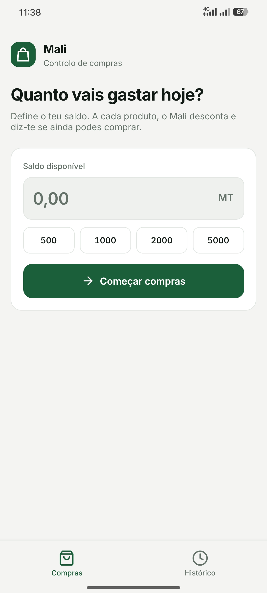
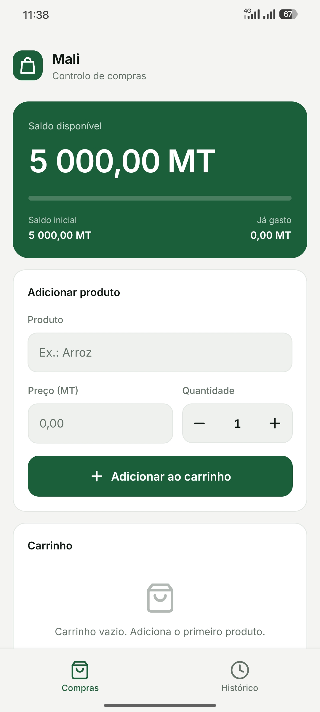
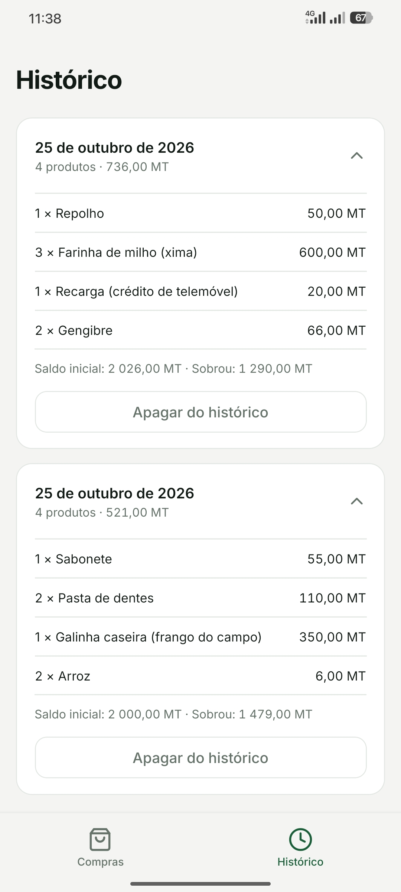
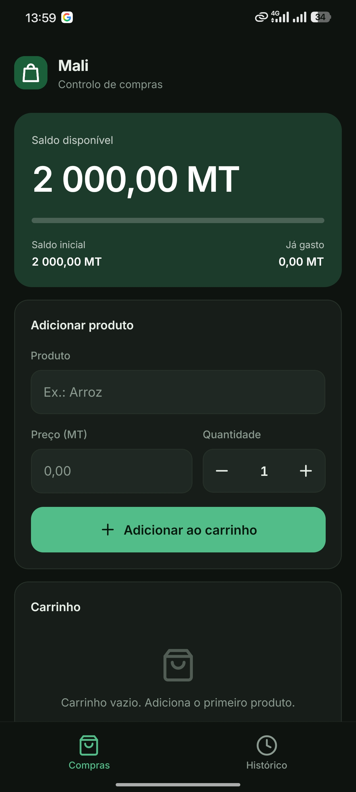

<p align="center">
  
</p>

<h1 align="center">Mali</h1>

<p align="center">Controlo de saldo durante as compras.</p>

---

## Sobre

O Mali é uma aplicação móvel para quem precisa de saber, a cada momento, quanto ainda pode gastar. Antes de começar as compras define-se um saldo. À medida que os produtos são adicionados, o valor é descontado, a aplicação indica se ainda é possível comprar e, no fim, mostra o total gasto. A compra pode ser guardada num histórico, que serve para consultar o que foi comprado no mês anterior e evitar esquecimentos.

O nome vem de *mali*, que significa dinheiro em changana.

## Capturas de ecrã

<!-- Substituir os ficheiros em docs/screenshots por capturas reais, mantendo os nomes. -->

<table>
  <tr>
    <td align="center"><br><sub>Início</sub></td>
    <td align="center"><br><sub>Compras</sub></td>
    <td align="center"><br><sub>Histórico</sub></td>
    <td align="center"><br><sub>Modo escuro</sub></td>
  </tr>
</table>

## Funcionalidades

- Saldo inicial, com valores rápidos de 500, 1000, 2000 e 5000 MT.
- Desconto automático a cada produto e bloqueio quando o produto não cabe no saldo.
- Indicação visual quando o saldo está a acabar.
- Pesquisa de produtos com sugestões, incluindo nomes usados em Moçambique, como xima, mancarra ou matapa.
- Preços sugeridos por produto, a partir de valores de referência e dos últimos preços pagos pelo utilizador.
- Quantidade com botões de incremento, sem necessidade de abrir o teclado.
- Finalização da compra e histórico consultável, com os produtos, o saldo inicial e o que sobrou.
- Funcionamento sem ligação à internet. Os dados ficam guardados no dispositivo.
- Tema claro e escuro, de acordo com a definição do sistema.

## Tecnologias

| Área | Tecnologia |
| --- | --- |
| Plataforma | Expo (SDK 57) e React Native 0.86 |
| Linguagem | TypeScript |
| Navegação | Expo Router |
| Animações | React Native Reanimated 4 |
| Armazenamento local | AsyncStorage |
| Tipografia | Inter, incluída na aplicação |
| Ícones | Feather, via `@expo/vector-icons` |

## Estrutura do projeto

```
mali/
├── app/
│   ├── _layout.tsx            Raiz da aplicação e carregamento de fontes
│   └── (tabs)/
│       ├── _layout.tsx        Barra de separadores
│       ├── index.tsx          Ecrã de compras
│       └── historico.tsx      Histórico de compras
├── src/
│   ├── store.tsx              Estado, regras de negócio e persistência
│   ├── AddProduct.tsx         Formulário, autocomplete e preços sugeridos
│   ├── Hero.tsx               Cartão do saldo
│   ├── ui.tsx                 Componentes comuns
│   ├── theme.ts               Cores e fontes
│   ├── format.ts              Formatação de valores e normalização de texto
│   └── data.ts                Lista de produtos e preços de referência
├── assets/                    Ícones, logótipo e imagens
├── docs/screenshots/          Capturas de ecrã usadas neste README
├── app.json
└── eas.json
```

## Como executar

Requisitos: Node.js (versão LTS), npm e um telemóvel ou emulador Android.

```bash
git clone https://github.com/<utilizador>/mali.git
cd mali
npm install
npx expo start
```

Para compilar e abrir diretamente num dispositivo ou emulador Android ligado:

```bash
npm run android
```

## Produtos e preços de referência

A lista de produtos e os preços sugeridos estão em `src/data.ts`:

- `PROD` contém os nomes dos produtos, incluindo designações locais entre parênteses.
- `PRC` associa o nome de um produto a uma lista de preços típicos, em meticais, por unidade, quilograma ou litro.

Os preços de referência são aproximados e servem apenas como ponto de partida. Variam por loja, cidade e época do ano. Os preços que o utilizador regista têm prioridade sobre os de referência e passam a ser sugeridos primeiro.

## Gerar o APK

O projeto usa o EAS Build. O perfil `preview` do `eas.json` produz um APK instalável diretamente no telemóvel.

```bash
npm install -g eas-cli
eas login
eas build -p android --profile preview
```

A configuração Android do `app.json` limita a compilação à arquitetura `arm64-v8a`, o que reduz o tamanho do ficheiro e exclui telemóveis de 32 bits. Para os incluir, acrescentar `armeabi-v7a` à propriedade `buildArchs` do plugin `expo-build-properties`.

## Estado do projeto

Em desenvolvimento. A publicação na Google Play está prevista.

## Autor

Ferdinaldo Pelembe, estudante de Engenharia Informática.

Contacto: `<email ou perfil>`

## Licença

Distribuído sob a licença MIT. Consultar o ficheiro [LICENSE](LICENSE).
